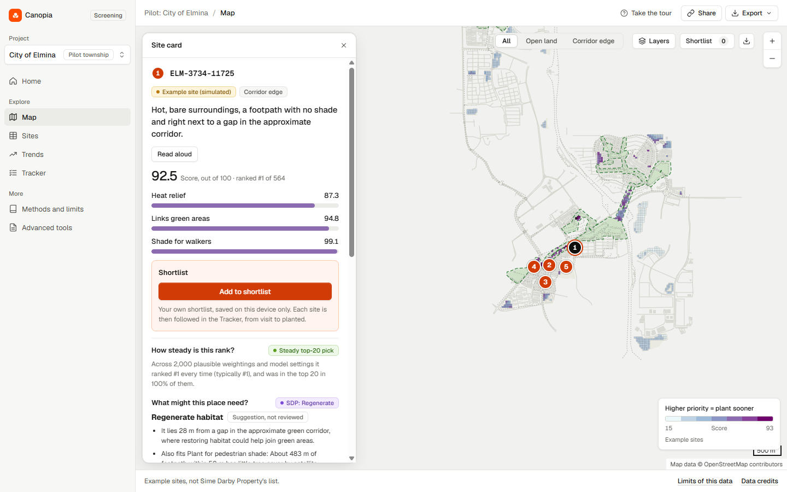
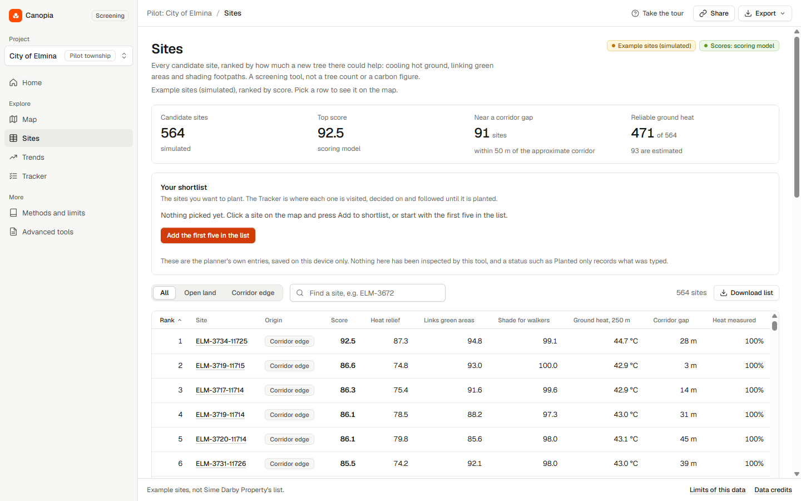
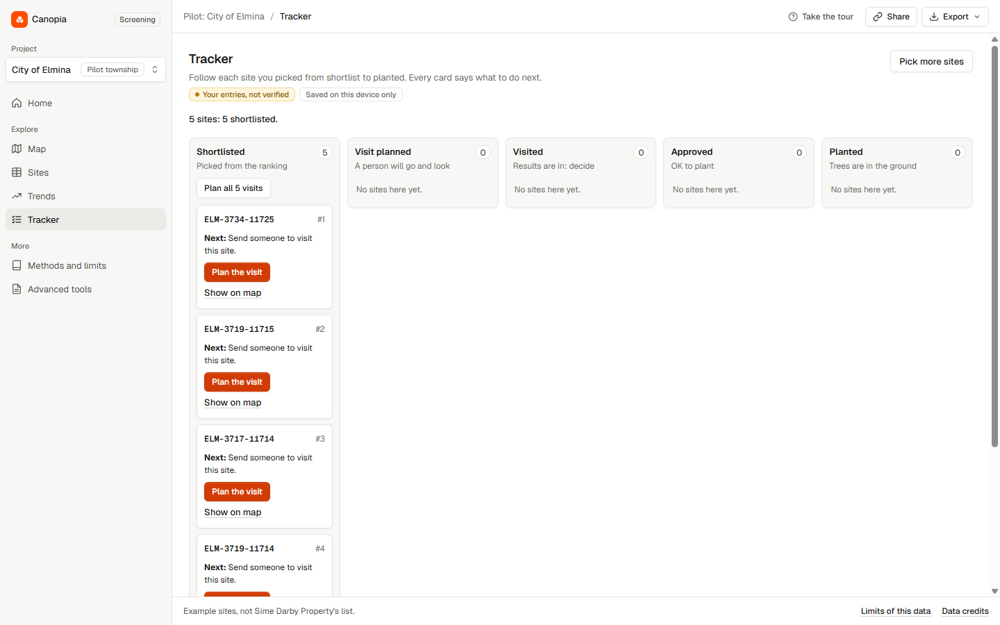
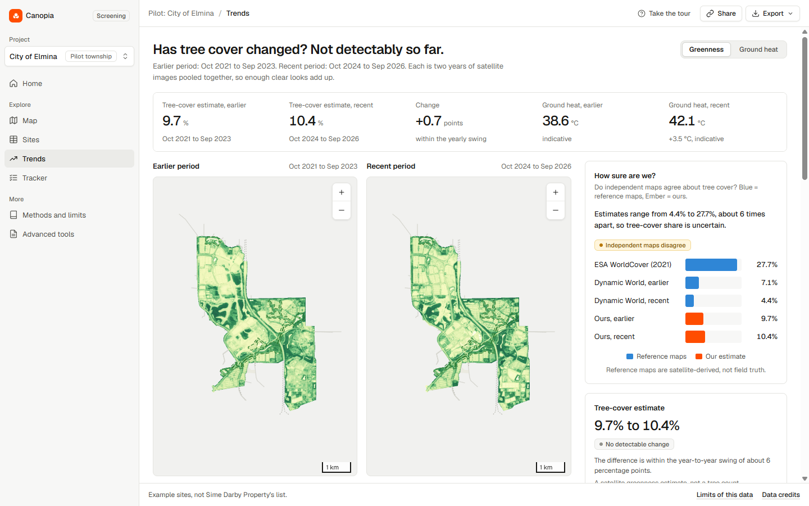
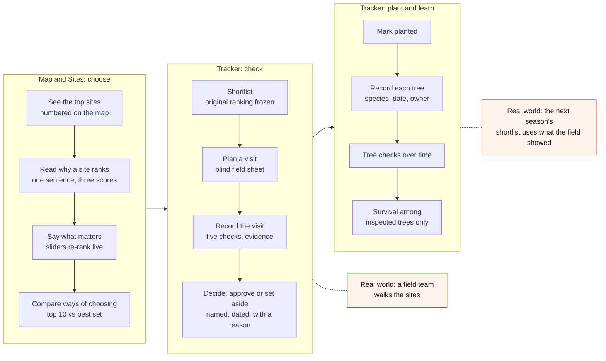
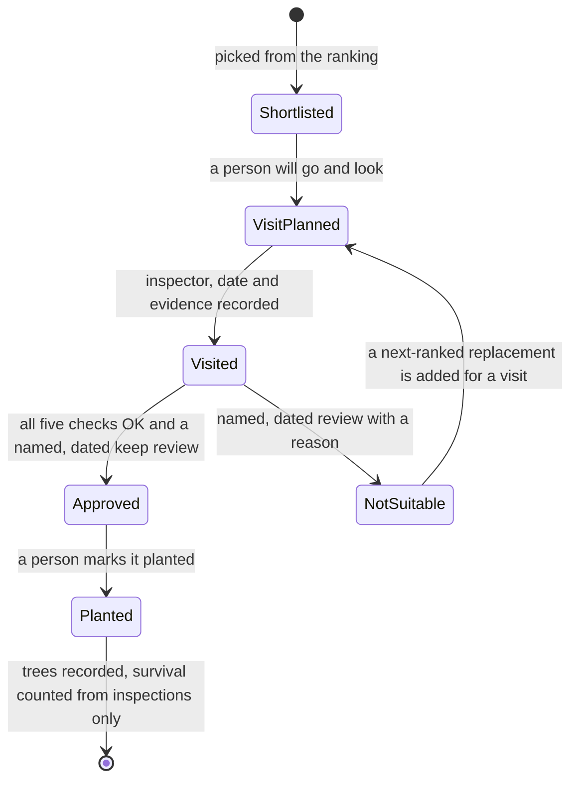
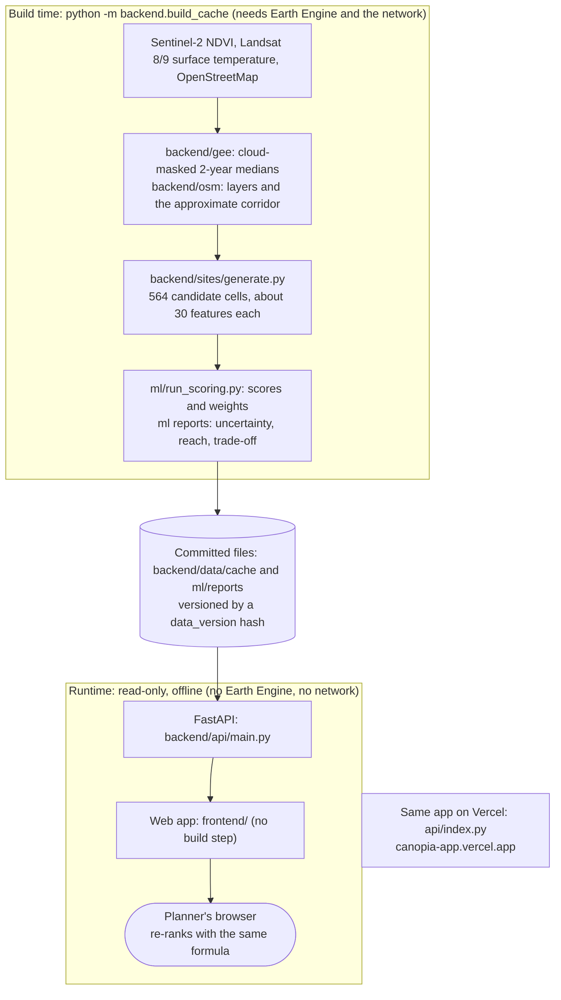
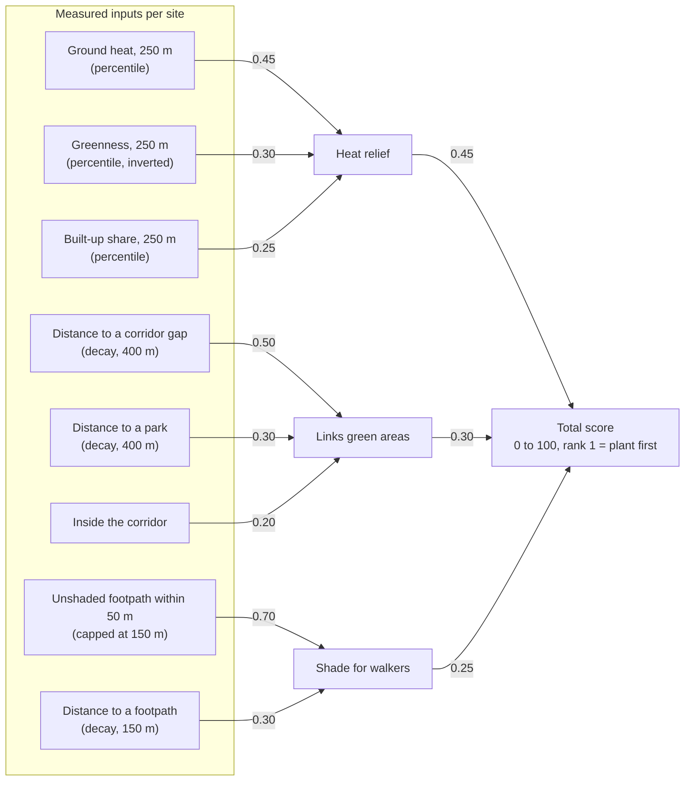

<p align="center">
  
</p>

# Canopia

**Where should we plant first, and why?** Canopia ranks candidate tree-planting sites across a township from satellite measurements and map data,
explains every rank in one sentence, and carries the shortlist through field checks to planting. Built by team Triple T for the Sime Darby Property
University Hackathon 2026 (Planet track, *Township of Tomorrow*), **piloted on City of Elmina** so the method can be repeated in other townships.

[](https://canopia-app.vercel.app)
[](https://github.com/mpip0505/simedarbyhackathon/actions/workflows/tests.yml)


> **Read this first.** A pilot of the *method* on real Elmina satellite and map data, not a pilot of real planting. The 564 candidate sites are **simulated**
> (we do not have Sime Darby Property's site list), there is **no ground truth**, and no field walks or user tests have been run yet. Canopia ranks where to look first;
> it is not a tree count, a carbon figure or an approval to plant. Every limit: [docs/limitations.md](docs/limitations.md).

## Contents
[60-second walkthrough](#60-second-walkthrough) · [What makes Canopia different](#what-makes-canopia-different) · [Screens](#screens) · [The user flow](#the-user-flow) ·
[Architecture](#architecture) · [How a site is scored](#how-a-site-is-scored) · [Run it](#run-it) · [Honest by design](#honest-by-design) ·
[Judging criteria](#how-this-maps-to-the-judging-criteria) · [Where everything is](#where-everything-is) · [Data credits](#data-credits)

## 60-second walkthrough
Open **https://canopia-app.vercel.app** (no login).
1. **Map:** click the site numbered 1. The card says why in one sentence, gives three scores and shows that the site ranked first in every one of 2,000 plausible weightings.
2. Move the **"What matters most?"** sliders. The list re-ranks in your browser and says how many of the top 10 changed.
3. **Sites:** every site in one sortable table, with what the first 50 sites reach.
4. **Tracker:** press *Add the first five ranked sites*, then *Plan the visit*. Each site moves from shortlisted to planted, and nothing is approved without five field checks and a named, dated review.
5. **Advanced tools:** press *Edit pilot plan*; step 2, *Check coverage*, sets the plain top 10 against the best-coverage round (10 sites chosen as a set). Field sheets, shade walks and scenarios are here too.
6. **Trends:** two satellite periods side by side, with the verdict "no detectable change" and the independent maps that disagree.

## What makes Canopia different
Each point has a number you can check and a file that produces it.

| | What | Evidence |
|---|---|---|
| **Measured, not assumed** | Every site score is computed from satellite measurements of the township: Sentinel-2 vegetation and Landsat ground heat (cloud-masked two-year medians), plus OpenStreetMap paths, parks and buildings. The sites are simulated; the measurements under them are real. | [`backend/gee/`](backend/gee/), [`backend/sites/generate.py`](backend/sites/generate.py), [data dictionary](docs/data-dictionary.md) |
| **Township-wide, tied to the corridor** | Ranks all 564 candidate 30 m sites across the township, not fixes along one route, and scores closing gaps in the 5 km Urban Biodiversity Corridor. | [`ml/scoring_model.py`](ml/scoring_model.py), [`backend/osm/corridor.py`](backend/osm/corridor.py) |
| **The best set, not just top scores** | Choosing 10 sites as a set reaches **51% more** exposed footpath and about **3 times** the corridor gap of the plain top 10, for a 6-point lower average score. | [`frontend/js/optimizer.js`](frontend/js/optimizer.js), [decision-support.md](docs/decision-support.md) |
| **Says how sure it is** | **14 of the top 20** stay in the top 20 in at least 80% of 2,000 plausible weightings. Independent maps put tree cover at **4% to 28%**, and the app shows that disagreement. | [`ml/uncertainty.py`](ml/uncertainty.py), [uncertainty report](ml/reports/uncertainty.md) |
| **Protect before planting** | **75** sites are already green by satellite, so they are flagged for an ecologist before any planting (a screening suggestion, not a finding). | [`frontend/js/intervention.js`](frontend/js/intervention.js), `node frontend/tools/intervention_counts.mjs` |
| **From ranking to the ground** | The Tracker, blind field sheets and a validated import compare field results with the model. A real site list drops in with one command, tested to reproduce the committed scores exactly. | [`frontend/js/tracker.js`](frontend/js/tracker.js), [`backend/my_sites.py`](backend/my_sites.py), [bring-your-own-sites.md](docs/bring-your-own-sites.md) |
| **Built to be checked** | One command rebuilds every number deterministically from free data. Test, check and page counts are generated, and CI fails if they drift. | [`backend/build_cache.py`](backend/build_cache.py), [docs/status.md](docs/status.md), [CI workflow](.github/workflows/tests.yml) |

How it compares with Tree Equity Score, i-Tree Landscape and Right Place, Right Tree: [docs/prior-art.md](docs/prior-art.md).

## Screens
The app has seven pages: **Home** (what this is and where to start), **Map** (full-screen map, sliders, ranked list, site card), **Sites** (every site in one sortable table, with the shortlist and analysis), **Trends** (two satellite periods, charts, an independent-map comparison), **Tracker** (each picked site on a board from shortlisted to planted, with one next step per card), **Methods and limits**, and **Advanced tools** (field sheets, evidence, costs and scenarios for a real pilot).

| Map and site card | Sites |
|---|---|
|  |  |

| Tracker | Trends |
|---|---|
|  |  |

Home: [docs/pitch/screens/20-home.png](docs/pitch/screens/20-home.png). Older screens from earlier versions stay in [docs/pitch/screens/](docs/pitch/screens/).

## The user flow
Everything inside the app is the **planner's own record**, saved in the browser. The two shaded boxes are the real-world work a pilot with Sime Darby Property adds.



The Tracker's stages and the rules between them (from [`frontend/js/tracker-logic.js`](frontend/js/tracker-logic.js) and `transitionProblem` in [`frontend/js/plan.js`](frontend/js/plan.js)):



Step by step, with what each step does today: [docs/pitch/user-flow.md](docs/pitch/user-flow.md).

## Architecture
Two halves that never mix: a **build** that needs Earth Engine and the network, and a **runtime** that serves the committed results with neither.



- **Deterministic:** a full rebuild from a fresh download reproduced the committed data: the same 564 site IDs and the same values (a test rebuilds the sites and compares them).
- **Offline at runtime:** the API never imports Earth Engine or OSM libraries (a test enforces it) and serves only `backend/data/cache/`.
- **Hosted safely:** on the public deployment the API docs and `/health/deep` are off and cross-origin access is closed; the web app is same-origin.

Module map, every API endpoint with its data file, the build steps in order, deployment and test layers: **[docs/architecture.md](docs/architecture.md)**.

## How a site is scored
Three scores from eight named inputs, then a weighted total. There are no labels to fit to, so nothing is trained: every number traces to its inputs.



The three right-hand weights are the default the sliders start from (`backend/data/cache/weights.json`); the planner can change them. The heat term is pulled towards the middle where ground temperature was filled in from neighbours. Plain-language write-up: [docs/ml-model.md](docs/ml-model.md); code: [`ml/scoring_model.py`](ml/scoring_model.py).

## Run it
Live: **https://canopia-app.vercel.app**. Locally (Python 3.12, no Earth Engine login, no internet):
```bash
pip install -r backend/requirements.txt
uvicorn backend.api.main:app --port 8000      # then open http://localhost:8000/ (API docs at /docs)
```
Score your own points with the same measurements and model, offline:
```bash
python -m backend.my_sites docs/examples/my_sites_example.csv
```
Tests (no network needed):
```bash
python -m pytest backend/tests ml/tests -q
node --test "frontend/tests/*.test.mjs"
node frontend/tools/smoke.mjs http://127.0.0.1:8000   # real-browser test, needs Chrome and the API running
python tools/project_status.py --check                 # counts in docs/status.md match the code
```
Current test, check and page counts are generated, not typed: [docs/status.md](docs/status.md). Rebuilding the data, the API and hosting: [docs/developer-guide.md](docs/developer-guide.md).

## Honest by design
An unknown stays unknown. Concretely:

| The tool never... | Because... |
|---|---|
| calls the sites real | they are simulated; the label is on every page, export and print-out |
| says a site is safe or approved | five OK checks are "not an approval"; a named, dated human review is required |
| counts an uninspected tree as surviving | survival is "among inspected trees"; with no records it says *No field data* |
| reads a canopy change as growth | the canopy proxy moves about 5 points between single years, so 9.7% to 10.4% is "no detectable change" |
| calls the siting screen a wildlife assessment | it flags only mapped roads, buildings and footpaths; there is no forest-edge layer |
| presents the OSM-only path as a second model | it is a licence fallback: a proximity screen that cannot see heat, tree cover or shade |
| hides that the corridor is approximate | the app says "approximate corridor" until an official polygon is supplied |
| invents field data | the example field and shade-walk files are marked SYNTHETIC; no walks or user tests have been run |

Before quoting a number, check [docs/pitch-fact-check.md](docs/pitch-fact-check.md) and the hard questions in [docs/judge-qa.md](docs/judge-qa.md).

## Pilot and scale
Elmina is the **pilot township**: the method ran end to end on its real satellite and map data, and nothing in the method is specific to it. What a second township needs, and what in the code is Elmina-specific: [docs/commercial-case.md](docs/commercial-case.md). What a real pilot adds (the real site list, the official corridor polygon, field plots, shared records): [docs/pilot-readiness.md](docs/pilot-readiness.md). The first request to Sime Darby Property is the **official corridor polygon**: drop it at `backend/data/input/corridor_official.geojson`, rebuild, and the app says "official polygon".

## How this maps to the judging criteria
Official weights: Impact 25, Innovation 20, Feasibility 20, Strategic Fit 15, Commercial 10, Team, Evidence and Pitch 10. Our own self-grade: [docs/grading-self-assessment.md](docs/grading-self-assessment.md).

| Criterion (weight) | Evidence in this repository | Honest gap |
|---|---|---|
| **Impact and sustainability (25)** | Reach of the first sites, each counted once ([ml/reports/impact_reach.md](ml/reports/impact_reach.md)); resident shade-exposure scenario; pilot measurement plan ([docs/pilot-readiness.md](docs/pilot-readiness.md)) | Reach, not outcome: no ground truth, no walks done |
| **Innovation (20)** | Best set over top scores, rank steadiness, protect before planting, frozen-ranking review loop ([docs/prior-art.md](docs/prior-art.md)) | Not a new satellite method, and we do not claim one |
| **Feasibility (20)** | Live at canopia-app.vercel.app, tested, deterministic rebuild, a real site list drops in ([docs/architecture.md](docs/architecture.md), [docs/status.md](docs/status.md)) | Simulated sites; noncommercial Earth Engine licence |
| **Strategic fit (15)** | Planet track, SDP's corridor, Avoid-Regenerate-Conserve suggestion ([docs/theme-fit.md](docs/theme-fit.md), [docs/decision-support.md](docs/decision-support.md)) | Priorities attributed to public statements, not yet confirmed with a mentor |
| **Commercial (10)** | Users, replication audit, licensing point, labelled hypotheses ([docs/commercial-case.md](docs/commercial-case.md)) | Hypotheses only: not run on a second township |
| **Team, evidence and pitch (10)** | Pitch kit ([docs/pitch/](docs/pitch/)), evidence summary ([docs/evidence-summary.md](docs/evidence-summary.md)), usability protocol, judge Q&A | No user test or field data yet |

## Where everything is
Full index by reader: [docs/README.md](docs/README.md).

| If you are... | Start with |
|---|---|
| a judge | this page, then [docs/judge-qa.md](docs/judge-qa.md) and [docs/evidence-summary.md](docs/evidence-summary.md) |
| an engineer | [docs/architecture.md](docs/architecture.md), [docs/developer-guide.md](docs/developer-guide.md), [docs/data-contract.md](docs/data-contract.md), [ml/README.md](ml/README.md) |
| a planner or pilot partner | [docs/pitch/user-flow.md](docs/pitch/user-flow.md), [docs/pilot-readiness.md](docs/pilot-readiness.md), [docs/bring-your-own-sites.md](docs/bring-your-own-sites.md) |
| preparing the submission | [docs/pitch/submission-checklist.md](docs/pitch/submission-checklist.md) |

| Path | What |
|---|---|
| `backend/` | FastAPI app, Earth Engine and OpenStreetMap pipeline, simulated-site generator, siting screen, OSM-only licence fallback, `my_sites` scorer |
| `ml/` | The scoring model, validation, rank steadiness, reach and trade-off reports |
| `frontend/` | The web app: plain HTML, JavaScript and Leaflet, no build step; unit tests and a real-browser test |
| `api/`, `vercel.json` | The Vercel entry point for the live demo |
| `docs/` | Everything written down; start at [docs/README.md](docs/README.md) |
| `tools/` | `project_status.py`, which measures the counts in [docs/status.md](docs/status.md) |

## Data credits
Map data (c) OpenStreetMap contributors (ODbL). Contains modified Copernicus Sentinel-2 data (European Space Agency).
Landsat 8/9 Collection 2 Level-2 data courtesy of the U.S. Geological Survey. ESA WorldCover and Google Dynamic World
used for the cross-check. Processed with Google Earth Engine (noncommercial use).
