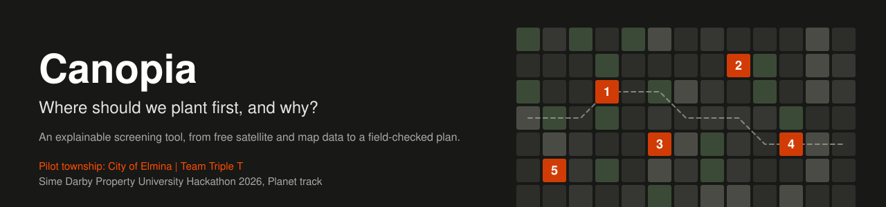
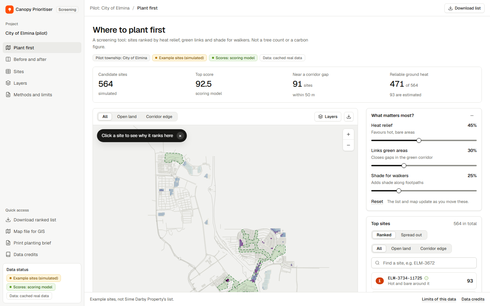
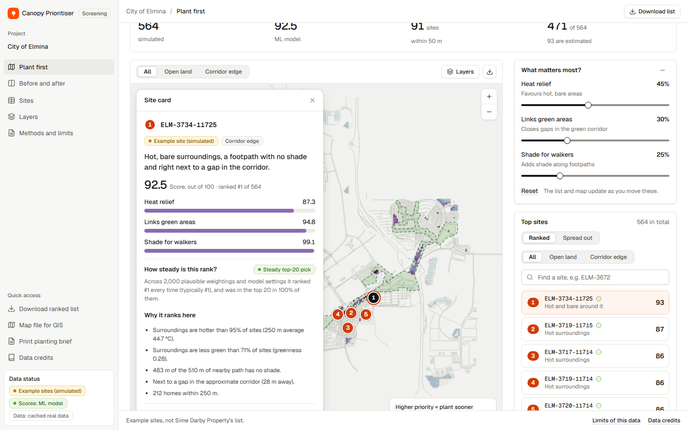
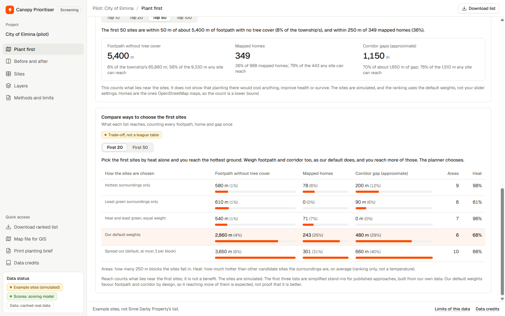
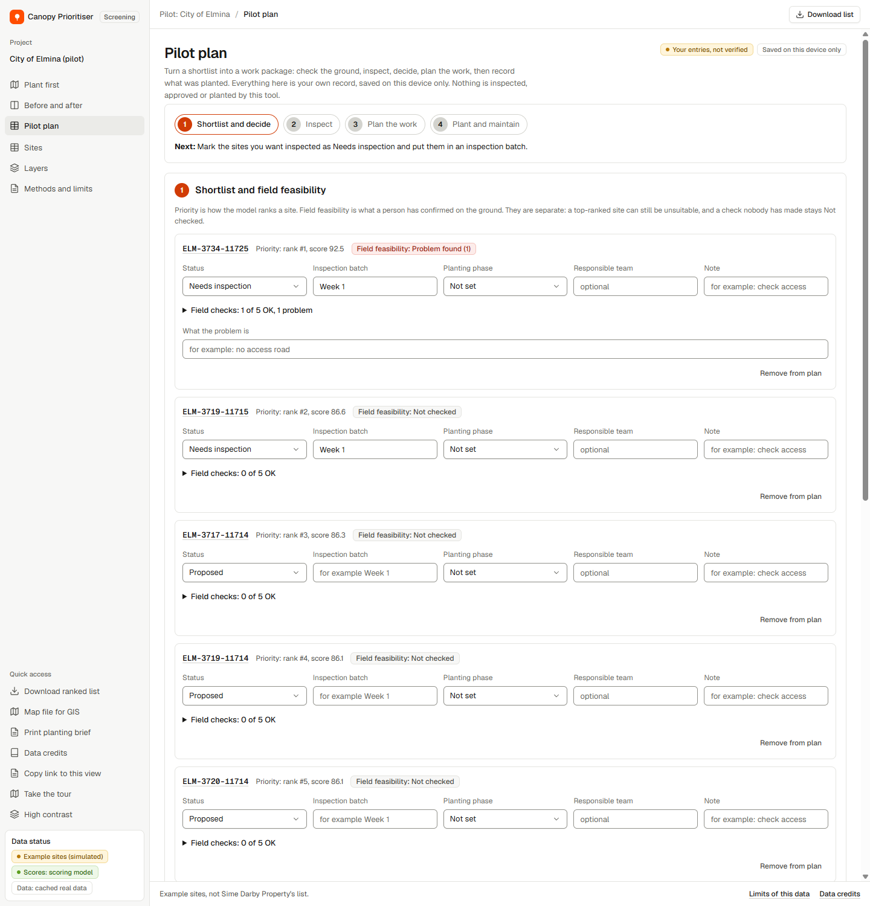
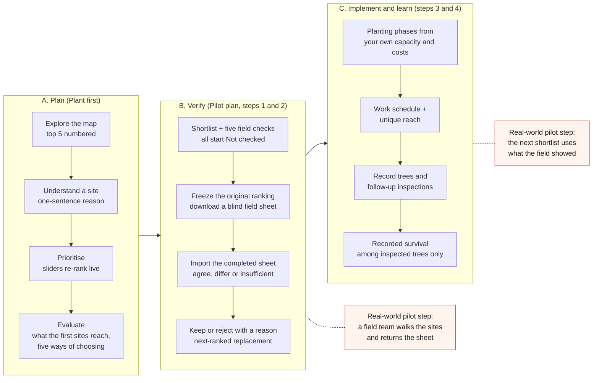
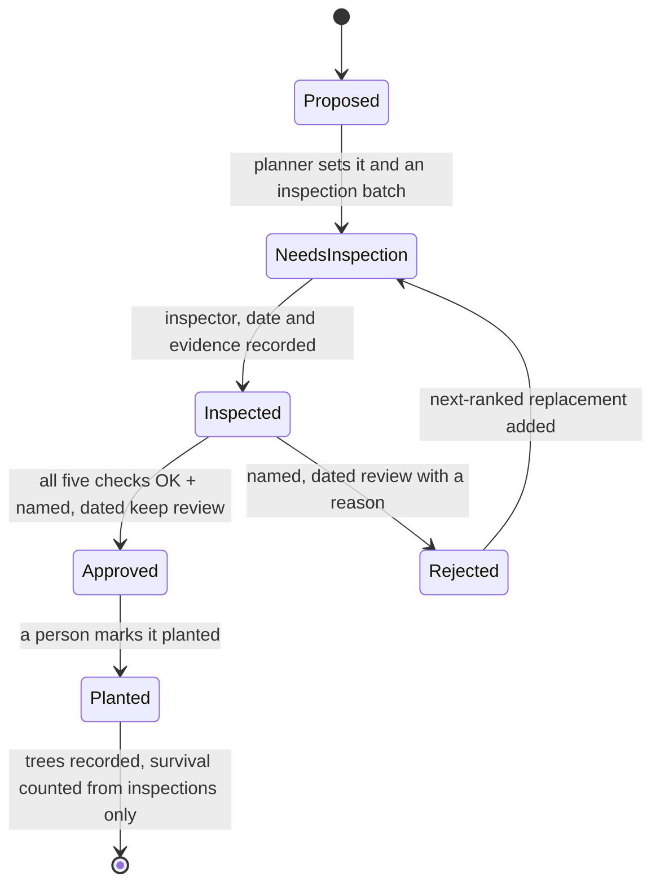
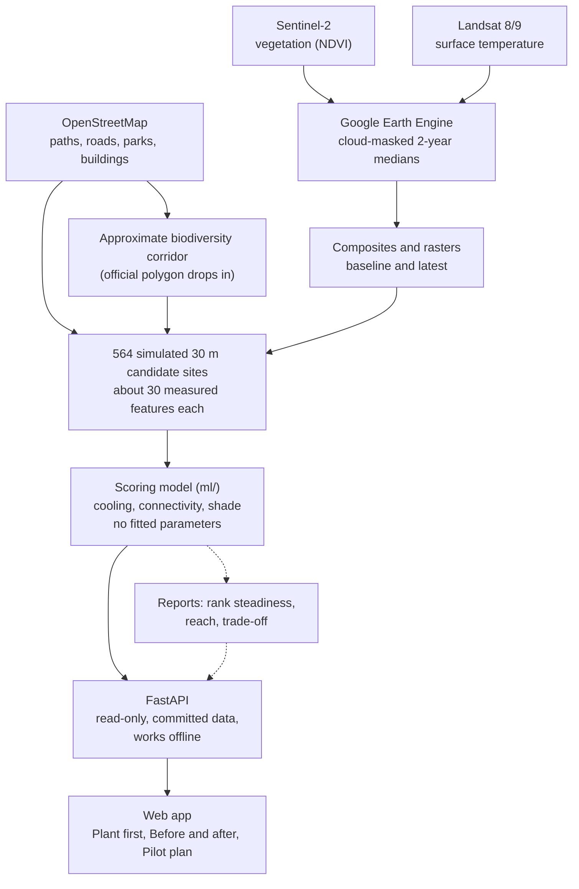

<p align="center">
  
</p>

# Canopia

**Where should we plant first, and why?** Canopia turns free satellite and map data into a ranked, explained shortlist of places to plant,
then helps a planner check that shortlist on the ground and turn it into a work plan. It was built for the Sime Darby Property University Hackathon 2026
(Planet track, theme *Township of Tomorrow*) by team Triple T, and **piloted on City of Elmina** so the method can be repeated in other townships.

> **Read this first.** This is a pilot of the *method* on real Elmina satellite and map data, not a pilot of real planting. The 564 candidate sites are **simulated**
> (we do not have Sime Darby Property's planting list), there is **no ground truth** (no tree inventory or field plots), and no field walks or user tests have been run yet.
> The tool ranks where to look first. It is not a tree count, a carbon figure or an approval to plant. Every limit is in [docs/limitations.md](docs/limitations.md).

## Contents
[Purpose](#purpose) · [Who it is for](#who-it-is-for) · [What it looks like](#what-it-looks-like) · [The user flow](#the-user-flow) · [How it works](#how-it-works) ·
[What is different](#what-is-different) · [Honest by design](#honest-by-design) · [Try it in three minutes](#try-it-in-three-minutes) · [Pilot and scale](#pilot-and-scale) ·
[How this maps to the judging criteria](#how-this-maps-to-the-judging-criteria) · [Where everything is](#where-everything-is) · [Data credits](#data-credits)

## Purpose
A township has a limited number of trees to plant each season, a long walking network with little shade, and a biodiversity corridor with gaps in it. Deciding *where* is slow,
and a map of canopy cover alone shows what is there, not what to do next. Canopia answers three questions, in order:

1. **Where first?** Every candidate site gets three scores (cooling, connectivity, shade) from named, transparent inputs. You change what matters and the ranking re-sorts live.
2. **Why there?** Each site gets a one-sentence reason, the measurements behind it, and how steady its rank is across 2,000 plausible weightings.
3. **What next?** The shortlist goes into a Pilot plan: five ground checks per site that start as *Not checked*, a blind field sheet to send out, the completed sheet brought back and compared with the model, keep-or-reject with a reason, phases, and recorded survival.

## Who it is for
A **landscape or sustainability planning officer** at a developer such as Sime Darby Property (a hypothesis to confirm with mentors), who must choose where a limited planting budget goes and justify the choice.
A sustainability analyst is served by a second view that shows the two satellite periods side by side with honest verdicts. Residents benefit indirectly: the tool counts the unshaded footpath and mapped homes the first sites reach.

## What it looks like
The dashboard has three views: **Plant first** (map, sliders, ranked list, site card), **Before and after** (two satellite periods, charts, an independent-map comparison) and **Pilot plan** (shortlist to field checks to work plan).

| Plant first | Site card |
|---|---|
|  |  |

| What the first sites reach, and five ways of choosing | Pilot plan: shortlist and field checks |
|---|---|
|  |  |

More screens (rank steadiness, footpath greenness, planting plan, timed shade walks) are in [docs/pitch/screens/](docs/pitch/screens/).

## The user flow
The planner's journey has three stages. Everything inside the app is the **planner's own record**, saved in the browser; the real-world work in the dashed boxes is what a pilot with Sime Darby Property would add.



What a site goes through, and what the tool will and will not let a planner claim:



The full step-by-step, with what each step does today and where it lives, is in [docs/pitch/user-flow.md](docs/pitch/user-flow.md).

## How it works


- **Imagery:** per-pixel *medians of cloud-masked scenes* over two-year windows, because tropical cloud makes single scenes unusable. Baseline 2021-10 to 2023-09, latest 2024-10 to 2026-09.
- **Candidates:** 30 m cells on open land and non-park corridor land, minus buildings and roads, labelled *simulated*.
- **Scores:** cooling, connectivity and shade, 0 to 100, from eight named inputs. There are no labels to fit to, so the model is transparent rather than trained, and it says so.
- **Offline by design:** the demo runs from the committed cache with no Earth Engine login and no internet. The API never imports Earth Engine or OSM libraries (a test enforces it).

Technical detail (API, rebuilding the data, reliability, security, tests): [docs/developer-guide.md](docs/developer-guide.md).

## What is different
Other canopy tools (Tree Equity Score, i-Tree Landscape, Boston's Right Place, Right Tree) are compared in [docs/prior-art.md](docs/prior-art.md). What this adds:

- **Site scale, not census areas:** 30 m candidate cells, each with a reason a planner can read aloud.
- **Rank steadiness on screen:** 14 of the top 20 stay in the top 20 in at least 80% of 2,000 plausible settings ([ml/reports/uncertainty.md](ml/reports/uncertainty.md)). Tools tend to agree on broad areas and differ on specific top sites, so showing how steady a pick is matters.
- **Reach, de-duplicated:** what the first sites actually touch (unshaded footpath, mapped homes, gaps in the approximate corridor), each counted once, and five ways of choosing compared as a trade-off, not a league table ([ml/reports/tradeoff.md](ml/reports/tradeoff.md)).
- **Best 10 together beats the top 10 on reach:** a best-coverage round reaches about 51% more footpath and about three times the (approximate) corridor gap of the plain top 10 ([docs/decision-support.md](docs/decision-support.md)).
- **Protect before you plant (a screening suggestion, not a finding):** 75 of the 564 example sites are already green by satellite, so the tool flags them for an ecologist's review before any planting. Reproduce: `node frontend/tools/intervention_counts.mjs`.
- **Your own sites can be dropped in:** any point inside the Elmina study area is measured by the same code and scored by the same model (`python -m backend.my_sites`), and a test proves a simulated site's own centre reproduces its committed scores exactly.
- **From ranking to field to plan:** a loop most map tools stop short of, with a frozen original ranking so later changes are compared against it.
- **Honest limits on screen**, not buried in a footnote.

## Honest by design
The project's rule is that an unknown stays unknown. Concretely:

| The tool never... | Because... |
|---|---|
| calls the sites real | they are simulated; the label is on every screen, export and print-out |
| says a site is safe or approved | five OK checks are "not an approval"; a named, dated human review is required |
| counts an uninspected tree as surviving | survival is "among inspected trees"; with no records it says *No field data* |
| reads a canopy change as growth | the canopy proxy moves about 5 points between single years, so the baseline-to-latest change is "no detectable change" |
| calls the siting screen a wildlife assessment | it flags only mapped roads, buildings and footpaths; there is no forest-edge layer |
| presents the OSM-only path as a second model | it is a licence fallback: a proximity screen that cannot see heat, tree cover or shade |
| hides that the corridor is approximate | the sidebar says "Corridor: approximate (OpenStreetMap)" until an official polygon is supplied |
| invents field data | the timed-shade-walk example file is marked SYNTHETIC; no walks or user tests have been run |

Quoting any number? Check it against [docs/pitch-fact-check.md](docs/pitch-fact-check.md) and the hard questions in [docs/judge-qa.md](docs/judge-qa.md) first.

## Try it in three minutes
Needs Python 3.12. No Earth Engine login and no internet are needed.
```bash
pip install -r backend/requirements.txt
uvicorn backend.api.main:app --port 8000
```
Open http://localhost:8000/ (the interactive API is at http://localhost:8000/docs). **Live link:** not deployed yet; `Dockerfile` and `render.yaml` are ready ([developer guide](docs/developer-guide.md#the-web-app)).

A short path through the app:
1. **Plant first:** click the site numbered 1 and read why it ranks there.
2. Move the "What matters most?" sliders so heat counts most; the note says how many of the top 10 changed.
3. Open the reach and trade-off cards: what the first sites reach, and five ways of choosing.
4. **Pilot plan:** press *Add the first five ranked sites*, then *Freeze original shortlist*, and download the blind field sheet. Every field check reads *Not checked*.
5. **Before and after:** two satellite periods, with the verdicts and the independent-map comparison.

**Have your own list of points?** `python -m backend.my_sites your_points.csv` scores them with the same measurements and model, offline ([docs/bring-your-own-sites.md](docs/bring-your-own-sites.md)).

Test counts, browser checks and views are measured, not typed: [docs/status.md](docs/status.md). `python -m pytest backend/tests ml/tests -q` and `node --test "frontend/tests/*.test.mjs"` run everything that needs no network.

## Pilot and scale
Elmina is the **pilot township**: the method was run end to end on its real satellite and map data, and nothing in the method is specific to it. What a second township needs, and what in the code is Elmina-specific, is audited in [docs/commercial-case.md](docs/commercial-case.md).
What a real pilot with Sime Darby Property would add (the real site list, the official corridor polygon, field plots, shared records) is in [docs/pilot-readiness.md](docs/pilot-readiness.md). The first request to Sime Darby Property is the **official corridor polygon**: drop it at `backend/data/input/corridor_official.geojson`, rebuild, and the app says "official polygon".

## How this maps to the judging criteria
The official scoring is Impact 25, Innovation 20, Feasibility 20, Strategic Fit 15, Commercial 10, Team, Evidence and Pitch 10. Where to find the evidence for each, and what is still missing, stated plainly. The full self-grade is [docs/grading-self-assessment.md](docs/grading-self-assessment.md).

| Criterion (weight) | Evidence in this repository | Honest gap |
|---|---|---|
| **Impact and sustainability (25)** | Reach of the top sites, de-duplicated ([ml/reports/impact_reach.md](ml/reports/impact_reach.md)); resident shade-exposure scenario; pilot measurement plan ([docs/pilot-readiness.md](docs/pilot-readiness.md)) | Reach, not outcome: no ground truth, no walks done |
| **Innovation (20)** | Rank steadiness, reach and trade-off, protect-before-plant, frozen-ranking review loop ([docs/prior-art.md](docs/prior-art.md)) | Not a new satellite method, and we do not claim one |
| **Feasibility (20)** | Runs offline from committed data, tested, deterministic rebuild, field-check kit, Dockerfile ([docs/developer-guide.md](docs/developer-guide.md), [docs/status.md](docs/status.md)) | Not deployed; the Docker image has not been built or run here |
| **Strategic fit (15)** | Planet track, Township of Tomorrow, Avoid-Regenerate-Conserve suggestion ([docs/theme-fit.md](docs/theme-fit.md), [docs/decision-support.md](docs/decision-support.md)) | Priorities are attributed to public statements, not confirmed with mentors |
| **Commercial (10)** | Users, replication steps, licensing point, labelled hypotheses ([docs/commercial-case.md](docs/commercial-case.md)) | Hypotheses only: nothing run on a second township, no buyer budget known |
| **Team, evidence and pitch (10)** | Pitch kit ([docs/pitch/](docs/pitch/)), evidence summary ([docs/evidence-summary.md](docs/evidence-summary.md)), usability protocol ([docs/usability-test-protocol.md](docs/usability-test-protocol.md)), judge Q&A | No user test or field data yet; the video is not recorded |

The pitch has two parts, **Mechanism** (the solution, how it works, who benefits, value to the township) and **Enabler** (how technology makes it work at township scale). The slide-by-slide mapping is in [docs/pitch/deck-outline.md](docs/pitch/deck-outline.md).

## Where everything is
The full index, grouped by who is reading, is [docs/README.md](docs/README.md). The short version:

| If you are... | Start with |
|---|---|
| a judge | this page, then [docs/judge-qa.md](docs/judge-qa.md), [docs/grading-self-assessment.md](docs/grading-self-assessment.md) and [docs/evidence-summary.md](docs/evidence-summary.md) |
| a planner or pilot partner | [docs/pitch/user-flow.md](docs/pitch/user-flow.md), [docs/pilot-readiness.md](docs/pilot-readiness.md), [docs/shade-walk-protocol.md](docs/shade-walk-protocol.md) |
| an engineer | [docs/developer-guide.md](docs/developer-guide.md), [docs/data-contract.md](docs/data-contract.md), [ml/README.md](ml/README.md) |
| preparing the submission | [docs/pitch/submission-checklist.md](docs/pitch/submission-checklist.md) |

| Path | What |
|---|---|
| `backend/` | FastAPI app, Earth Engine and OpenStreetMap pipeline, simulated-site generator, siting screen, OSM-only licence fallback |
| `ml/` | The scoring model, validation, rank steadiness, reach and trade-off reports |
| `frontend/` | The web app: plain HTML, JavaScript and Leaflet, no build step; unit tests and a real-browser test |
| `docs/` | Everything written down; start at [docs/README.md](docs/README.md) |
| `tools/` | `project_status.py`, which measures the counts in [docs/status.md](docs/status.md) |

## Data credits
Map data (c) OpenStreetMap contributors (ODbL). Contains modified Copernicus Sentinel-2 data (European Space Agency).
Landsat 8/9 Collection 2 Level-2 data courtesy of the U.S. Geological Survey. ESA WorldCover and Google Dynamic World
used for the cross-check. Processed with Google Earth Engine (noncommercial use).
