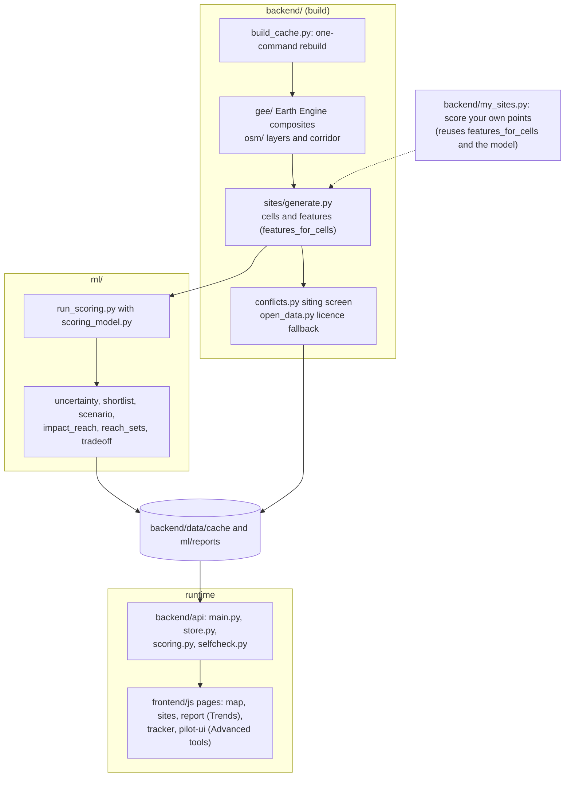
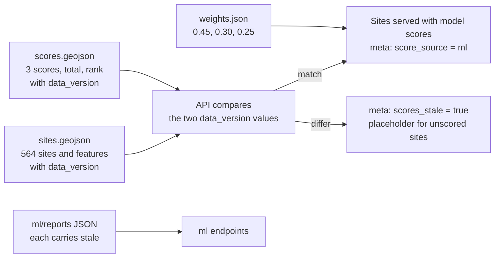
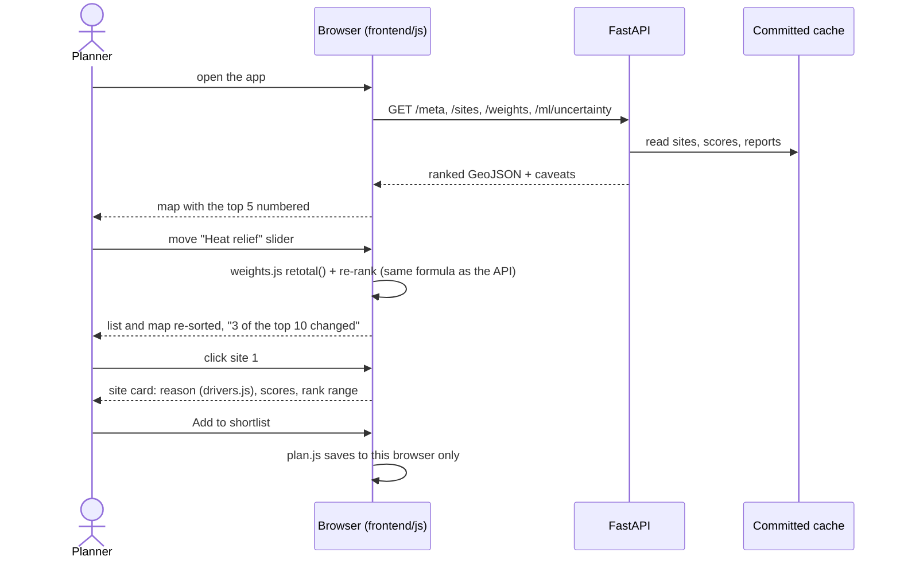

# Architecture

Written for: engineers and technical judges who want to see how Canopia is built. The overview and the user flow are in the [README](../README.md); running and rebuilding are in the [developer guide](developer-guide.md); every limit is in [limitations.md](limitations.md).

Canopia has two halves that never mix. The **build** turns satellite imagery and OpenStreetMap into a versioned set of files; it needs Earth Engine and the network. The **runtime** serves those committed files to a static web app; it needs neither, so the demo works offline and on a read-only host.

## 1. Repository map


## 2. Build pipeline
`python -m backend.build_cache` runs these steps in order and stops at the first failure (`STEPS` in [`backend/build_cache.py`](../backend/build_cache.py)). `--skip-gee` reuses the cached rasters; `--offline` also skips the OSM download.

| Step | Module | Output |
|---|---|---|
| 1. OSM download | `backend.osm.fetch_api` | raw OSM extract |
| 2. OSM layers | `backend.osm.from_pbf` | paths, roads, parks, buildings, open land, study area |
| 3. Corridor | `backend.osm.build_corridor` | approximate corridor (or the official polygon if supplied) |
| 4. Composites | `backend.gee.export` | NDVI and surface-temperature rasters, before/after summary |
| 5. Series | `backend.gee.series` | yearly canopy and temperature |
| 6. Sensitivity | `backend.gee.sensitivity` | canopy share at three thresholds |
| 7. Cross-check | `backend.gee.crosscheck` | agreement with ESA WorldCover and Dynamic World |
| 8. Overlays | `backend.overlays` | map overlay images |
| 9. Sites | `backend.sites.generate` | `sites.geojson`, `site_features.csv` with `data_version` |
| 10. Siting screen | `backend.conflicts` | roads, buildings and footpaths near each site |
| 11. Licence fallback | `backend.open_data` | OSM-only proximity screen |

Then the scoring model writes the scores and the reports read them:
```bash
python -m ml.run_scoring        # weights.json, then scores.geojson (validated, stamped with data_version)
python -m ml.uncertainty        # and ml.shortlist, ml.scenario, ml.impact_reach, ml.reach_sets, ml.tradeoff
```
Every cache file is written atomically (temp file, then swap), so a reader never sees a half-written file.

## 3. The data contract

Scores carry the data version they were computed on, so a rebuild that changes the sites makes stale scores visible instead of silently wrong. Field-by-field: [data-contract.md](data-contract.md) and [data-dictionary.md](data-dictionary.md).

## 4. API
All endpoints are `GET` and read-only ([`backend/api/main.py`](../backend/api/main.py)). Errors are small JSON bodies with a `request_id`.

| Endpoint | Serves | From |
|---|---|---|
| `/sites`, `/sites/{id}` | ranked sites; weights in the query re-rank live | `sites.geojson` + `scores.geojson` |
| `/weights` | the default slider weights | `weights.json` |
| `/meta` | data mode, score source, staleness, corridor source, caveats, attribution | cache + build info |
| `/summary`, `/summary/series`, `/summary/crosscheck` | before/after, yearly series, independent-map comparison | `summary.json`, `series.json`, `crosscheck.json` |
| `/layers/corridor`, `/layers/corridor/spine`, `/layers/osm/{name}`, `/layers/paths/shade` | map layers | cache GeoJSON |
| `/layers/overlays`, `/layers/overlays/{name}.png` | before/after images and bounds | `overlays/` |
| `/screening/conflicts`, `/screening/open-data` | siting screen, licence fallback | `conflicts.json`, `open_data_sites.geojson` |
| `/ml/uncertainty`, `/ml/shortlist`, `/ml/scenario`, `/ml/impact`, `/ml/reach-sets`, `/ml/tradeoff` | the model's reports | `ml/reports/` |
| `/health`, `/health/deep` | liveness; full data check (off on the public deployment) | self-check |
| `/app/` | the web app | `frontend/` |

## 5. One interaction, end to end
Moving a slider never calls the server: the browser re-totals the three scores with the same formula as the API. A fixture test runs both and requires identical totals and ranks ([`frontend/tests/weights.test.mjs`](../frontend/tests/weights.test.mjs)).


## 6. Deployment

- [`vercel.json`](../vercel.json) sends every path to [`api/index.py`](../api/index.py), which imports the same app the [`Dockerfile`](../Dockerfile) serves. Nothing is written at runtime, so the read-only file system is fine.
- On the production deployment (`VERCEL_ENV=production`) the interactive docs (`/docs`, `/openapi.json`) and `/health/deep` return 404, and CORS allows no other origin unless `CORS_ORIGINS` lists one. Local runs keep all of them.
- Public errors never contain file paths or exception text; details go to the server log.

## 7. Tests and checks
| Layer | Runs | What it protects |
|---|---|---|
| Python (`backend/tests`, `ml/tests`) | pytest, in CI | API contract, resilience, scoring, docs consistency, `my_sites` reproducing committed scores, offline imports |
| Frontend unit (`frontend/tests`) | node --test, in CI | ranking formula parity, plan and Tracker rules, CSV safety, copy that must stay honest |
| Browser (`frontend/tools/smoke.mjs`) | real Chrome, locally or against the live URL | every page, keyboard use, hostile API text, an axe-core accessibility scan |
| Data (`backend.api.selfcheck`) | in CI and at startup | every cache file against the contract |
| Counts (`tools/project_status.py --check`) | in CI | the numbers in [status.md](status.md) match the code |

CI: [`.github/workflows/tests.yml`](../.github/workflows/tests.yml). Live Earth Engine steps cannot run in CI; they run with `python -m backend.build_cache` and a login.
