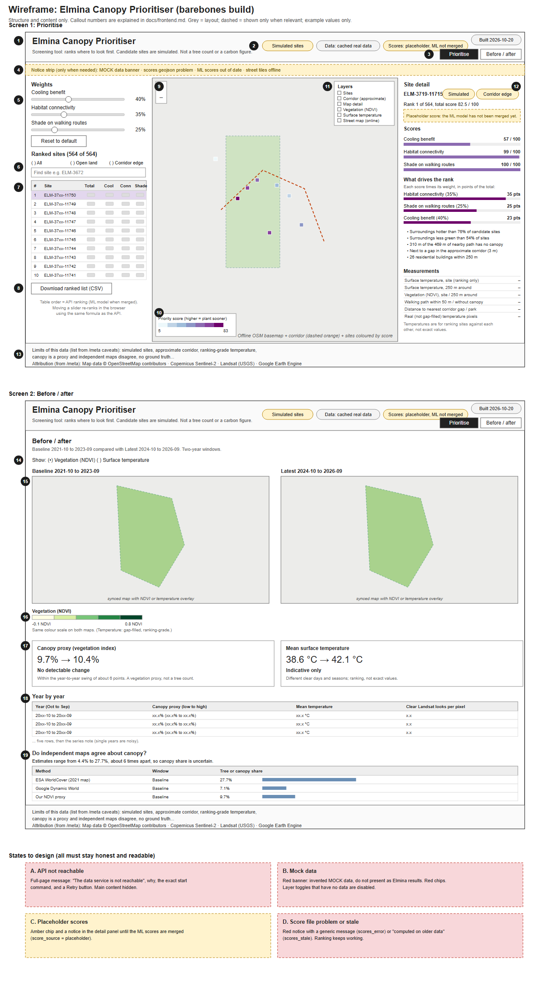

# Frontend: the dashboard build and designer brief

Written for: whoever designs or extends the interface. The app is a **working dashboard**: a sidebar, a top bar and two views
(now seven pages after the Canopia redesign: Home, Map, Sites, Trends, Tracker, Methods and limits, Advanced tools). Its look is the Canopy dashboard system, documented in [design-system.md](design-system.md) and
drawn live on `frontend/styleguide.html`. The look lives in `css/app.css` and can be replaced without touching the data or the
maths. The UX it implements (journey, wording, states) is in [ux-wireframe.md](ux-wireframe.md), which describes the earlier
map-first wireframe; the content, wording and honesty rules there still apply, the layout is now the one in the design system.



`docs/wireframe.svg` is the earlier table-based layout. The component list below describes the data each part uses.

## Run it
```bash
pip install -r backend/requirements.txt
uvicorn backend.api.main:app --port 8000
# open http://localhost:8000/   (redirects to /app/)
```
No Node and no build step are needed to run it. Leaflet is bundled in `frontend/vendor/leaflet/` (checked against the
published hashes), and the map draws from our own cached OpenStreetMap layers, so it works **offline**.
To point a separately hosted design at the API, open it with `?api=http://localhost:8000` (the API allows cross-origin GET).
Only a **localhost address (any port) or the page's own origin** is accepted; anything else is ignored with a visible notice, so a
crafted link cannot make the page load data from someone else's server.

## What each part is, where its data comes from, and what must stay
| # | Component | Data (all `GET`) | Notes for the designer |
|---|---|---|---|
| 1 | Page title and screening note | static text | **Keep** the screening-tool wording: it is not a tree count or a carbon figure |
| 2 | Status chips (Sites page header) | `/meta`: `data_mode`, `score_source`, `generated_at` | **Keep** "Example sites (simulated)" always, and the score-source chip (amber while scores are placeholders). |
| 3 | Sidebar and top bar | none | Sidebar: a project switcher, then pages only (Home; Explore: Map, Sites, Trends, Tracker; More: Methods and limits, Advanced tools). A first visit opens on Home. The Map is full screen with floating panels; the figures, table, shortlist and analysis are on Sites. Top bar: breadcrumb, Take the tour, Share, Export (CSV, GIS file, planting brief) |
| 4 | Notices | `/meta`: `data_mode`, `scores_error`, `scores_stale` | A preview-scores notice shows while scores are placeholders; red notices for mock data or a rejected score file |
| 5 | Strip of figures | computed from `/sites` (Map) and `/summary` (Trends) | Four tiles over the map (sites, top score, near a corridor gap, reliable ground heat), five over the before/after maps |
| 6 | Weight sliders | `/weights` (starting values) | Three sliders, 0 to 100, shown as a share of the total. Reset returns to the API's ranking |
| 7 | Filters and search | `/sites` | Origin (all, open land, corridor edge) above the map and in Top sites (kept in step), and a site-id search |
| 8 | Top sites list | `/sites` | Five rows in a window of fixed height ("See all" scrolls through the rest inside it, so the page never jumps), each with a one-sentence reason. Click or Enter selects; shared with the map. Numbered badges (up to 5) mark the top sites on the map; a rank of 100 or more gets a wider pill |
| 9 | CSV download | built in the browser | The ranked list with the `source` (simulated) and `score_source` columns kept. Offered in the top bar, the map card, the list and the sidebar |
| 10 | Map card | `/layers/osm/{name}`, `/layers/corridor`, `/layers/corridor/spine`, `/sites` | Offline basemap, approximate corridor (dashed spine), sites coloured by total score, source credit on the map. The card is as tall as the right-hand column ("What matters most?" plus "Top sites") |
| 11 | Legend | computed | Score range of the current ranking, with a colourblind-safe ramp |
| 12 | Layers panel | `/layers/overlays` | A popover from the map card: sites, corridor, map detail, vegetation and temperature overlays, optional online street tiles |
| 13 | Site card | `/sites` | A panel on the left of the map, so the rest of the map stays usable: a one-sentence reason, total and three score bars, then "Why it ranks here" and the numbers (collapsed). The map moves to keep the picked site clear of it. Escape or the close button closes it; picking another site swaps it in place. A sheet along the bottom of the map on a phone |
| 14 | Honesty bar and dialogs | `/meta`: `caveats`, `attribution` | **Keep** the limits list and the data credits (OpenStreetMap's licence requires attribution) |
| 15 | Metric toggle | none | Vegetation (NDVI) or surface temperature |
| 16 | Two synced maps | `/layers/overlays` | Earlier left, recent right, same colour scale, panning and zooming linked, approximate corridor outlined |
| 17 | Shared legend | `/layers/overlays` | Numeric range from the overlay metadata. **Keep** "gap-filled, ranking-grade" for temperature |
| 18 | Verdict cards | `/summary`, `/summary/series` | **Keep** the honest verdicts: "No detectable change" and "Indicative only" |
| 19 | Independent-map comparison ("How sure are we?") | `/summary/crosscheck`, `/summary` | **Keep**: it shows tree-cover estimates range from about 4% to 28% depending on the method |
| 20 | Year by year: two charts and a table | `/summary/series` | Tree cover with a low to high range, ground heat with the warmest year marked, clear Landsat looks per pixel. Hover or focus a bar for its numbers |

### States to design
A. API not reachable (the shell stays, the page explains how to start the API). B. Mock data. C. Placeholder scores.
D. Score file problem or out of date. E. Nothing selected (the first-visit hint). F. No sites match the filters. See the wireframe.

## Content rules (a Node test enforces the first three)
Always show that sites are **simulated** and when scores are **placeholders**; never show per-site temperature change;
never word the canopy change as growth; never say "reportable", "defensible" or "accurate"; never show the 10,266 or
"5% planted" figure (see `pitch-fact-check.md`); always credit the data sources; label overlays as gap-filled.
`frontend/tests/copy.test.mjs` fails if banned phrases appear or the marked elements (`data-required="honesty"` in
`index.html`) are removed. A redesign may reword anything, but must keep the meaning.

## Reuse this, restyle the rest
```
frontend/
  index.html            structure, element ids (the scripts find elements by id), the icon sprite
  css/app.css           tokens and components of the dashboard system: replace freely, keep the ids and classes the scripts use
  styleguide.html       every component on one page, drawn with app.css (css/styleguide.css is only its page layout)
  js/
    weights.js          re-total and re-rank for new weights. MUST match the API exactly. Reuse unchanged.
    drivers.js          "what drives this site's rank": weighted points and plain-language notes. Reuse.
    scale.js            colour ramp, number formats, percentiles. Reuse.
    report-logic.js     honest wording and numbers for the before/after view (headline, verdicts, figures, bars). Reuse.
    stats.js            the four figures above the map. Pure. Reuse.
    sites-table.js      the Sites table's columns, filtering and sorting. Pure. Reuse.
    sites.js            draws the Sites table. Replace as needed.
    badge.js            sizes of the rank labels (circle, or a pill from 100) and the list's rank column. Pure. Reuse.
    charts.js           vertical bar charts from DOM nodes (scale, geometry, tooltips). No chart library. Reuse.
    csv.js              CSV export. Reuse.
    api.js              fetch helpers with timeouts and one retry; apiUrl() for overlay images. Reuse.
    dom.js, state.js    tiny helpers (el(), icon(), a small store). Replace if you adopt a framework.
    strip.js            draws a strip of figures. Replace as needed.
    map.js, list.js, panel.js, sliders.js, report.js, main.js   the interface wiring. Replace as needed.
  vendor/leaflet/       Leaflet 1.9.4 (BSD-2), bundled so the demo works offline
  vendor/fonts/         Geist and Geist Mono (OFL 1.1) and Atkinson Hyperlegible (fallback, OFL 1.1), bundled for offline use;
                        provenance and hashes in vendor/fonts/geist/README.md
  tests/                Node unit tests + the Python-generated fixture
  tools/smoke.mjs       real-browser test; tools/make_wireframe.py draws the wireframe
```
**The one rule that matters:** `weights.js` must give exactly the same totals and ranks as the API's
`?w_cooling=&w_connectivity=&w_shade=` re-ranking. Its rounding is not `Math.round`: Python rounds exact ties to the
even digit (72.25 becomes 72.2), and naive JavaScript rounding disagreed with the API on 505 of 2,611 test values.
`backend/scripts/make_frontend_fixture.py` records what the backend returns, `tests/weights.test.mjs` replays it, and
`backend/tests/test_frontend_fixture.py` fails if the backend and the fixture drift apart.

Until a slider moves, the table shows the API's own ranking (the scoring model's, once merged). Only after a slider moves does
the browser re-rank, and the page says so.

## Test it
```bash
node --test "frontend/tests/*.test.mjs"   # unit tests, no dependencies (Node 22; quote the pattern); counts are in status.md
# or:  cd frontend && npm test
python -m pytest backend/tests -q       # includes the static-serving and endpoint tests
node frontend/tools/smoke.mjs           # real Chrome or Edge drives the app; needs the API running on port 8000
# once:  cd frontend && npm install   (adds axe-core, so the smoke test also scans both views for WCAG 2.2 A/AA problems)
```
The smoke test loads the page, clicks a row, drags the sliders, filters (both filters stay in step), searches, opens the layers
panel, toggles layers, switches views and temperature/vegetation, checks the unreachable-API message and a narrow screen
(the sidebar becomes a strip), fails on any console error or stray
text such as `null` or `[object ...]`, and writes screenshots (`node frontend/tools/smoke.mjs <baseUrl> <folder>`).
Set `CHROME_PATH` if the browser is somewhere unusual.

## Security rules for any redesign
- **API text is data, never markup.** Build DOM with text nodes or `textContent`; never `innerHTML`. Leaflet treats a *string*
  given to `setTooltipContent`, `bindTooltip` or `bindPopup` as **HTML**, so pass a DOM node (this was a real hole, now fixed
  in `js/map.js`).
- Keep the `?api=` restriction in `js/api.js` (`resolveApiBase`).
- `tests/safety.test.mjs` scans the scripts for these patterns, and `tools/smoke.mjs` runs a hostile API (site ids that are
  HTML with an `onerror` handler) against the real page and fails if any script runs or markup becomes an element.

## Known limits of this build
- Charts are bars drawn from DOM nodes (`js/charts.js`), not a chart library and not plotted lines. The layout has been checked
  at 1440, 1100 and 390px wide in Chromium, not on other browsers or real touch devices.
- The site card is a panel over the left of the map. On a small map it can cover the sites you are looking at, so the map is moved to keep the picked site clear of it; a tall card scrolls inside itself.
- Rank badges that would overlap are nudged apart (rank 1 stays on its site), so a badge can sit a few pixels off its cell.
- The online street-map toggle needs internet, and OpenStreetMap's tile policy applies (light use, with attribution).
- While ML scores are not merged, everything shows the labelled placeholder. The interface switches automatically when
  `score_source` becomes `ml`.
- Site cells are 30 m, so they are small at the default zoom; a designed version may want a zoom-dependent marker size.

## Evidence workflow modules

`review.js` owns frozen snapshots and safe import previews; `review-ui.js` connects freeze, issued blind sheets, confirmation, attributed review and evidence export. `decision-benchmark.js` compares equal-size methods and seeded random distributions. `plan.js` retains v1/v2 records in v3 storage and enforces new evidence gates. See [validate-review-replan.md](validate-review-replan.md). For focused smoke debugging, set `SMOKE_MATCH` to a substring of a check name; unset it for the complete suite. Automated synthetic checks are not independent-human usability results.
