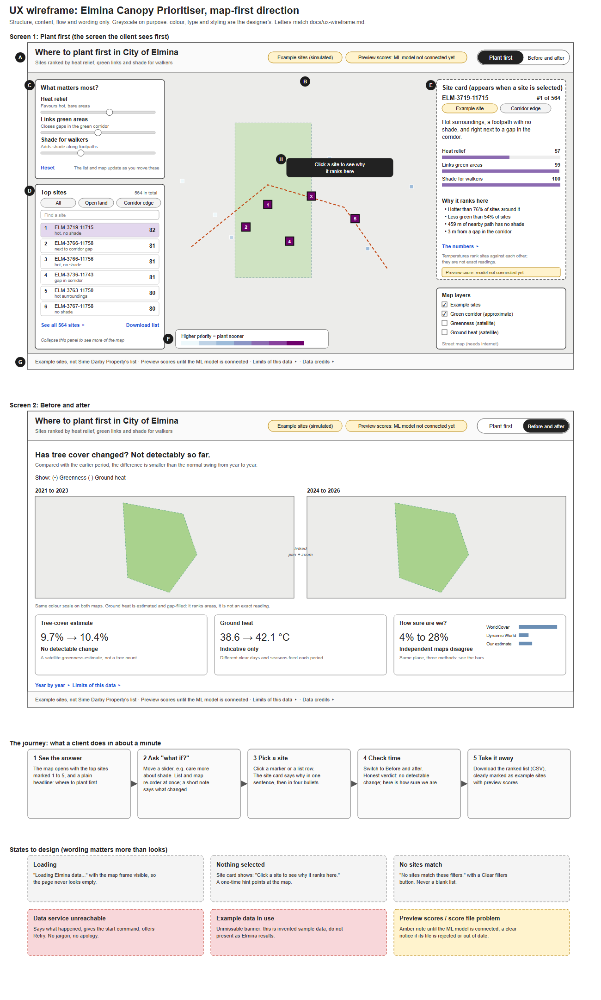

# UX wireframe: what the client sees (map-first direction)

Written for: the designer, and anyone deciding what the client sees and does. **UX, not UI**: structure, content, flow and
wording. Colour, type and styling are left to the designer. This is the **target** experience; the app that exists today
(`frontend/`, see [frontend.md](frontend.md)) is the dashboard build of the same data: a sidebar and two views, with the panels beside and under the map (see [design-system.md](design-system.md)).

Editable source: `docs/ux-wireframe.svg` (regenerate with `python frontend/tools/make_ux_wireframe.py`).

## The one question the screen answers
**"Where should we plant trees first in City of Elmina, and why?"**

The 10-second test: someone who has never seen it should look at the opening screen and be able to say *where* the first sites
are, and that the sites are examples with preview scores. Everything else is there to help them trust or change that answer.

## The main screen, part by part (letters match the wireframe)
| | Part | Its job for the client | What it contains | Behaviour |
|---|---|---|---|---|
| A | Top strip | Say what this is, at once | Title, one-line explanation, the honesty labels (example sites, preview scores), and the switch between Plant first and Before and after | Always visible. The honesty labels never hide |
| B | The map | Show the answer | Offline map of Elmina, green corridor (approximate), all example sites coloured by priority, **the top five marked 1 to 5** | Hover: site name and rank. Click: opens the site card. Zoom and pan as usual |
| C | What matters most? | Let the client ask "what if?" | Three sliders in plain words: heat relief, links green areas, shade for walkers, each with a one-line hint | List and map update as the slider moves. A short note says what changed (for example "3 of the top 10 changed"). Reset returns to the default |
| D | Top sites | Give the order of work | The first few sites with rank, name, **one-line main reason** and score; filters (all, open land, corridor edge); find a site; "See all"; download | Click a row: the map centres on it and the site card opens. The panel collapses to free the map |
| E | Site card | Explain one site | Name and rank, a one-sentence reason, three simple score bars, "Why it ranks here" in four bullets, the numbers behind it (collapsed), a caution that temperatures rank sites, not exact readings | Appears on selection. Empty state: "Click a site to see why it ranks here" |
| F | Legend and map layers | Decode the map | "Higher priority = plant sooner" colour bar; switches for example sites, corridor, greenness and ground heat (satellite), optional street map | Sites and corridor on by default |
| G | Honesty bar | Keep the data honest | Example sites, not Sime Darby Property's list; preview scores until the model is connected; Limits of this data; Data credits | Always visible and slim. Limits and credits open as sheets |
| H | First-visit hint | Tell a newcomer what to do | "Click a site to see why it ranks here" | Shown once, dismissed by the first click |

## Before and after
A plain headline first (**"Has tree cover changed? Not detectably so far."**), then two linked maps (earlier and later period)
with a greenness / ground heat switch, then three small cards: tree-cover estimate, ground heat, and **"How sure are we?"**,
which shows that independent maps disagree (about 4% to 28%). "Year by year" and "Limits of this data" open below.
The headline and card verdicts come from the data (`frontend/js/report-logic.js`), so they stay honest if the numbers change.

## The journey (about a minute)
1. **See the answer.** The map opens with the top sites marked and a headline saying where to plant first.
2. **Ask "what if?"** Move a slider; the order changes at once and a note says how much.
3. **Pick a site.** Click it; the card explains why in a sentence, then four bullets.
4. **Check time.** Switch to Before and after for the honest verdict and how sure we are.
5. **Take it away.** Download the ranked list, clearly marked as example sites with preview scores.

## Plain wording (use these on screen; keep the honest words)
| Instead of | Say |
|---|---|
| Cooling benefit | Heat relief |
| Habitat connectivity | Links green areas |
| Shade on walking routes | Shade for walkers |
| NDVI, vegetation index | Greenness (satellite) |
| Land surface temperature | Ground heat (satellite) |
| Corridor gap | Gap in the green corridor |
| Canopy proxy | Tree-cover estimate |
| Gap-filled | Estimated from nearby pixels |
| Placeholder scores | Preview scores: ML model not connected yet |
| Simulated sites | Example sites (simulated). Keep the word **simulated** visible somewhere |

Never say: reportable, defensible, accurate, "canopy increased". Never show the 10,266 or "5% planted" figure
(see [pitch-fact-check.md](pitch-fact-check.md)). Describe the canopy change as "not detectable", not as growth.

## States (the words matter more than the look)
- **Loading:** "Loading Elmina data..." with the map frame already in place, so the page never looks empty.
- **Nothing selected:** the site card invites a click.
- **No sites match:** "No sites match these filters." with a Clear filters button, never a blank list.
- **Data service unreachable:** says what happened, gives the start command, offers Retry. No jargon, no apology.
- **Example data in use:** an unmissable banner that this is invented sample data.
- **Preview scores / score file problem:** an amber note until the ML model is connected; a clear notice if its file is rejected
  or out of date. The ranking keeps working.
- **Small screens:** (target) panels become sheets. In the built app the sidebar becomes a strip along the top and the panels stack under the map.

## Priorities
- **Must have:** the map with the top sites marked, the top-sites list, the site card with reasons, the three sliders, the
  honesty bar, and Before and after.
- **Should have:** filters and search, layer switches, the CSV download, the first-visit hint.
- **Nice to have:** compare two sites side by side, a shareable link to a selection, a print view.

## What changed in the app to deliver this (implemented)
Mostly presentation, plus small logic that reuses the tested modules. No backend change was needed.
1. A large map card with the panels beside it (stacked under it on small screens), and the site card as a panel on the left of the map.
2. Larger markers with rank numbers for the top five sites, so they are visible at the opening zoom.
3. A one-line main reason per site in the list (derived from `drivers.js`).
4. The plain-language renames above.
5. A short note after each slider move saying how many of the top 10 changed.
6. A first-visit hint, a loading state and a no-match state.
7. `frontend/tests/copy.test.mjs` now checks the new wording ("ML model not connected yet", "Preview score") and still requires
   the simulated and preview-score labels, the honesty bar and the banned-phrase scan.

## Open questions for the team
- How many sites to mark on opening: five, ten or twenty?
- Is "Where to plant first in City of Elmina" the right headline, or should it name the township owner?
- Is comparing two sites needed for the pitch, or is the site card enough?
- Should the street-map option stay, given it needs internet and the demo is offline?
- Default slider weights come from the ML developer: confirm who decides them.
